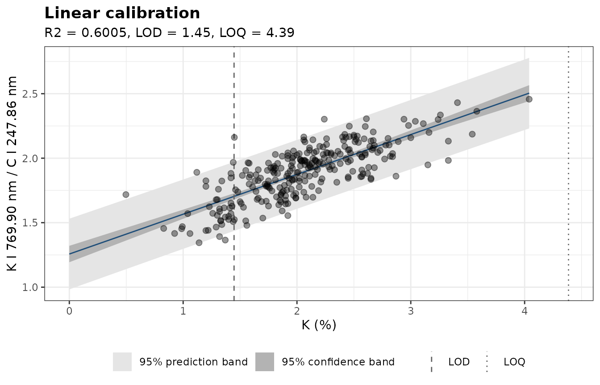
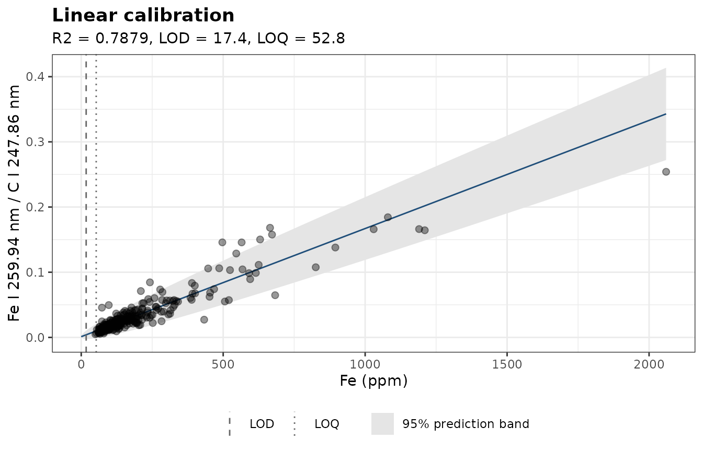
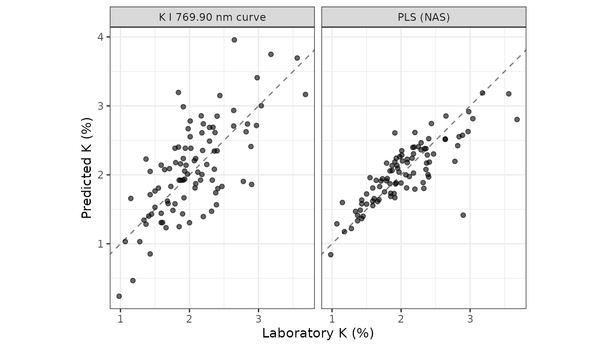
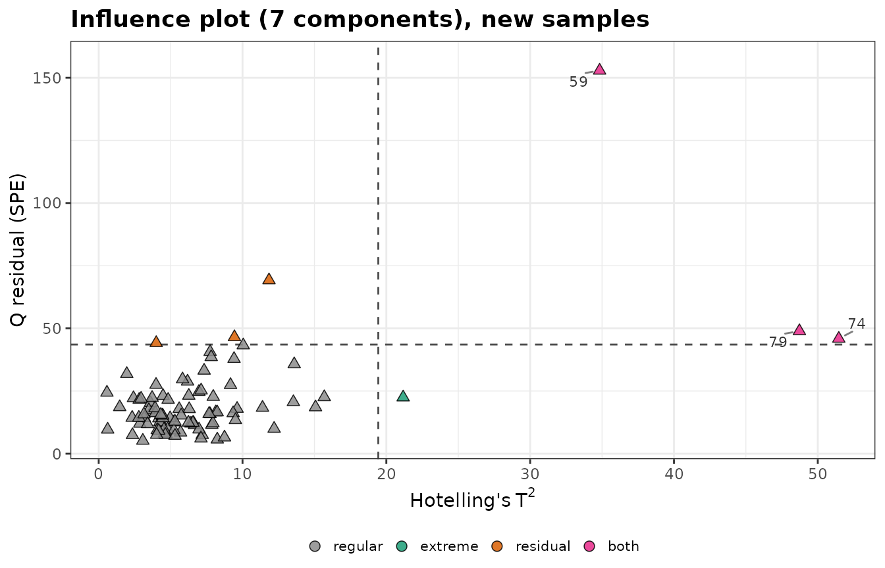
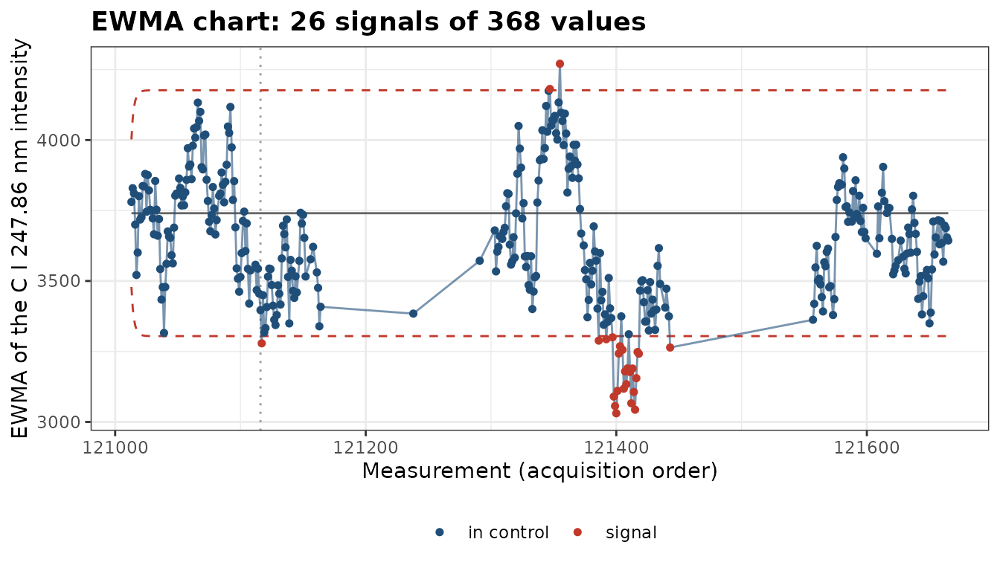

# 3. Calibration curves and figures of merit

A calibration relates a signal to the concentration of an element, from
samples of known composition, and predicts the concentration of new
samples. This vignette builds univariate calibration curves from line
intensities, with their limits of detection and quantification, and
compares them with a multivariate model of the whole spectrum, whose
figures of merit come from the net analyte signal. It ends with routine
analysis: whether new spectra lie within the calibration space, how to
transfer the calibration to another instrument, and whether the
instrument drifts.

``` r

library(specProc)
library(dplyr)
library(tidyr)
library(ggplot2)

data("forageLIBS")
spectra_id <- forageLIBS |> select(1:2) |> names()
minerals <- forageLIBS |> select(3:14) |> names()
spectra <- forageLIBS |> select(-all_of(c(spectra_id, minerals)))
```

## Line intensities

We remove the baseline and measure, in every spectrum, the intensities
of a potassium line, an iron line and the carbon line C I 247.86 nm.
Carbon is the main element of the forage matrix, and dividing by its
line compensates for the changes of ablated mass and plasma from
spectrum to spectrum (the internal standard of
[`vignette("preprocessing")`](https://christiangoueguel.com/specProc/articles/preprocessing.md)):

``` r

corrected <- baseline_arpls(spectra, lambda = 1e5, max_iter = 20)$correction

lines <- c(C = 247.856, K = 769.896, Fe = 259.940)
intensities <- line_intensities(corrected, lines) |>
  select(spectrum, line, intensity) |>
  pivot_wider(names_from = line, values_from = intensity)

data <- forageLIBS |>
  select(all_of(spectra_id), K, Fe) |>
  mutate(K_signal = intensities$K / intensities$C,
         Fe_signal = intensities$Fe / intensities$C)
```

We set aside a quarter of the samples to test the calibrations:

``` r

set.seed(1)
test_samples <- sample(unique(data$Sample), round(0.25 * n_distinct(data$Sample)))
calibration <- filter(data, !Sample %in% test_samples)
test <- filter(data, Sample %in% test_samples)
c(calibration = nrow(calibration), test = nrow(test))
#> calibration        test 
#>         275          93
```

## A calibration curve for potassium

[`calibration_curve()`](https://christiangoueguel.com/specProc/reference/calibration_curve.md)
fits the signal as a function of the concentration, and returns the
coefficients, the figures of merit and tests of linearity:

``` r

k_curve <- calibration_curve(calibration, K_signal, K)
k_curve
#> Linear calibration curve (275 standards)
#> 
#>       term estimate std_error  lower  upper
#>  intercept   1.2570   0.03232 1.1934 1.3206
#>      slope   0.3087   0.01524 0.2787 0.3387
#> 
#> R-squared:    0.60055
#> Sensitivity:  0.3087
#> LOD:          1.45  (residual)
#> LOQ:          4.39
#> Mandel:        F = 4.52, p = 0.0345
#> Lack of fit:   F = 1.12, p = 0.258
```

- **The sensitivity** is the slope: the change of the signal for 1% of
  K.
- **The limits of detection and quantification**, 3.3\\\sigma/S and
  10\\\sigma/S, use here the residual standard deviation \sigma of the
  fit. It includes every source of scatter around the curve, not only
  the noise of a blank, so the limits, 1.4% and 4.4% K, describe this
  calibration rather than the instrument.
- **Mandel’s test** compares the straight line with a quadratic curve.
  Its p-value, 0.034, points to a slight curvature, as expected for a
  resonance line, which the plasma partly reabsorbs at high
  concentration.

[`plot_calibration()`](https://christiangoueguel.com/specProc/reference/plot_calibration.md)
draws the curve with its confidence band (where the mean signal lies)
and its prediction band (where a single new measurement is expected):

``` r

plot_calibration(k_curve)
```



[`predict()`](https://rdrr.io/r/stats/predict.html) inverts the curve:
it gives the concentration of new samples from their signals, with a
prediction interval, and flags the values below the limits of detection
and quantification:

``` r

k_predicted <- predict(k_curve, test$K_signal)
head(k_predicted)
#> # A tibble: 6 × 8
#>   signal concentration    se lower upper below_lod below_loq outside_range
#>    <dbl>         <dbl> <dbl> <dbl> <dbl> <lgl>     <lgl>     <lgl>        
#> 1   2.23          3.17 0.443 2.29   4.04 FALSE     TRUE      FALSE        
#> 2   1.89          2.05 0.439 1.18   2.91 FALSE     TRUE      FALSE        
#> 3   2.06          2.61 0.440 1.74   3.48 FALSE     TRUE      FALSE        
#> 4   2.16          2.93 0.442 2.06   3.80 FALSE     TRUE      FALSE        
#> 5   1.83          1.86 0.439 0.996  2.73 FALSE     TRUE      FALSE        
#> 6   1.85          1.92 0.439 1.06   2.79 FALSE     TRUE      FALSE
sqrt(mean((k_predicted$concentration - test$K)^2))   # RMSEP, % K
#> [1] 0.4828623
```

The limit of quantification of this curve, 4.4% K, is above the
potassium content of almost every sample, so 100% of the predictions are
flagged `below_loq`: a single line ranks the samples, but does not
quantify them individually with the usual 10\\\sigma margin.

The limits above follow the ICH convention. ISO 11843-2 and IUPAC define
them by the risks of a false positive (\alpha) and of a false negative
(\beta), and include the uncertainty of the curve itself: the critical
value is the content above which potassium is declared present, and the
limit of detection, the content detected with probability 1 - \beta:

``` r

k_iso <- calibration_curve(calibration, K_signal, K, lod_convention = "iso11843")
k_iso$figures_of_merit |> select(critical_value, lod, loq)
#> # A tibble: 1 × 3
#>   critical_value   lod   loq
#>            <dbl> <dbl> <dbl>
#> 1          0.744  1.49  4.51
```

With risks of 5%, the limit of detection, 1.5% K, is close to that of
the ICH convention: with 275 standards, the uncertainty of the curve is
small next to the scatter of the samples.
[`predict()`](https://rdrr.io/r/stats/predict.html) then marks the
samples above the critical value as `detected`.

## Uncertain reference values

Least squares treat the laboratory values as exact. Their errors bias
the slope toward zero (regression dilution) and narrow the intervals.
York’s regression weights each standard by the uncertainties of both its
concentration and its signal. The uncertainty of the laboratory values
is not given with these data, so we take, for illustration, a relative
standard uncertainty of 5%; that of the signal follows from the noise of
the spectra (`intensity_se` of
[`line_intensities()`](https://christiangoueguel.com/specProc/reference/line_intensities.md)):

``` r

noise <- line_intensities(corrected, lines[c("C", "K")]) |>
  mutate(relative_se = intensity_se / intensity) |>
  select(spectrum, line, relative_se) |>
  pivot_wider(names_from = line, values_from = relative_se)
data <- data |>
  mutate(K_se = 0.05 * K, K_signal_se = K_signal * sqrt(noise$K^2 + noise$C^2))
calibration <- filter(data, !Sample %in% test_samples)
test <- filter(data, Sample %in% test_samples)

k_york <- calibration_curve(calibration, K_signal, K, regression = "york",
                            concentration_se = K_se, signal_se = K_signal_se)
k_york
#> Linear calibration curve (275 standards, York regression)
#> 
#>       term estimate std_error  lower  upper
#>  intercept   0.8789   0.05284 0.7749 0.9830
#>      slope   0.5314   0.02996 0.4724 0.5904
#> 
#> R-squared:    0.60055
#> Chi-squared:  18.4 (reduced)
#> Sensitivity:  0.5314
#> LOD:          1.23  (residual)
#> LOQ:          3.71
#> Mandel:        F = 4.52, p = 0.0345
#> Lack of fit:   F = 1.12, p = 0.258
```

The slope rises from 0.309 to 0.531, and the prediction error on the
test samples falls from 0.48 to 0.39% K. But the reduced chi-squared,
18, shows that the standards scatter far more than these uncertainties
explain: matrix effects, not the noise of the spectra or the assumed
errors of the laboratory values, dominate. York’s weights then mostly
lower the weight of the richest standards, whose 5% uncertainty is the
largest, much like weights `"1/x2"`, rather than correct the dilution of
the slope; its standard errors are scaled up accordingly. York’s
regression is at its best with reference materials whose certified
uncertainties, and the replicate measurements of their signals, describe
the scatter (a reduced chi-squared near 1). When every standard has the
same uncertainties, `regression = "deming"`, with the ratio of their
variances, is the simpler alternative.

## Trace elements: weights and limits of detection

Iron ranges from 50 to 2060 ppm, and its signal is noisier at high
concentration. An unweighted fit is then dominated by the few rich
samples, and so is its residual standard deviation, which inflates the
limit of detection. Weights `"1/x"` give each sample a weight inversely
proportional to its concentration. With weights, the residual standard
deviation depends on their scale, so the blank standard deviation is
taken from the standard error of the intercept
(`lod_method = "intercept"`):

``` r

fe_calibration <- filter(calibration, !is.na(Fe))
fe_unweighted <- calibration_curve(fe_calibration, Fe_signal, Fe)
fe_weighted <- calibration_curve(fe_calibration, Fe_signal, Fe, weights = "1/x",
                                 lod_method = "intercept")

bind_rows(unweighted = fe_unweighted$figures_of_merit,
          weighted = fe_weighted$figures_of_merit, .id = "fit") |>
  select(fit, n, r_squared, lod, loq)
#> # A tibble: 2 × 5
#>   fit            n r_squared   lod   loq
#>   <chr>      <int>     <dbl> <dbl> <dbl>
#> 1 unweighted   272     0.852 295.  895. 
#> 2 weighted     272     0.788  17.4  52.8
```

``` r

plot_calibration(fe_weighted, interval = "prediction")
```



The weighted fit gives a limit of detection of 17 ppm, instead of 295
ppm. Its R² is lower, because it no longer favors the rich samples,
which dominate R².

``` r

fe_test <- filter(test, !is.na(Fe))
fe_predicted <- predict(fe_weighted, fe_test$Fe_signal)
count(fe_predicted, below_loq)
#> # A tibble: 2 × 2
#>   below_loq     n
#>   <lgl>     <int>
#> 1 FALSE        84
#> 2 TRUE          9
median(abs(fe_predicted$concentration - fe_test$Fe) / fe_test$Fe)   # relative error
#> [1] 0.2138503
```

## A multivariate model and its figures of merit

A single line uses a small part of the spectrum. Partial least squares
(PLS) regression uses all of it: we divide the baseline-corrected
spectra by the carbon line, and choose the number of components by
cross-validation on the calibration samples, with the pls package:

``` r

x <- as.matrix(corrected) / intensities$C
is_calibration <- !data$Sample %in% test_samples
x_calibration <- x[is_calibration, ]

cv <- pls::plsr(K ~ x, data = data.frame(K = data$K[is_calibration], x = I(x_calibration)),
                ncomp = 15, validation = "CV", segments = 10)
ncomp <- pls::selectNcomp(cv, method = "onesigma")
ncomp
#> [1] 7
```

[`nas()`](https://christiangoueguel.com/specProc/reference/nas.md) fits
the same model and computes its net analyte signal (NAS): the part of
each spectrum that is unique to potassium, orthogonal to the
contributions of the other constituents. The figures of merit follow
from it:

- **Sensitivity**: the NAS produced by 1% of K.
- **Selectivity**: the fraction of each spectrum used for prediction.
- **Limits of detection and quantification**, 3.3\\\sigma_x/\mathrm{SEN}
  and 10\\\sigma_x/\mathrm{SEN}, where \sigma_x is the noise of the
  spectra (`noise`).

We estimate the noise from the three samples measured twice, as the
standard deviation of their difference spectra divided by \sqrt{2}:

``` r

repeated <- data$Sample[duplicated(data$Sample)]
differences <- sapply(repeated, \(s) {
  rows <- which(data$Sample == s)
  x[rows[1], ] - x[rows[2], ]
})
noise <- sd(differences) / sqrt(2)

k_nas <- nas(x_calibration, data$K[is_calibration], ncomp = ncomp, noise = noise)
k_nas$figures_of_merit
#>            sensitivity            selectivity analytical_sensitivity 
#>              4.0183608              0.1183193             29.9163896 
#>                    lod                    loq 
#>              0.1103074              0.3342649
```

``` r

nas_predicted <- predict(k_nas, x[!is_calibration, ])
sqrt(mean((nas_predicted$predicted - test$K)^2))   # RMSEP, % K
#> [1] 0.2964224
summary(nas_predicted$selectivity)
#>      Min.   1st Qu.    Median      Mean   3rd Qu.      Max. 
#> 0.0009985 0.0479909 0.0875087 0.1082689 0.1542453 0.3520663
```

``` r

bind_rows(
  `K I 769.90 nm curve` = tibble(laboratory = test$K, predicted = k_predicted$concentration),
  `PLS (NAS)` = tibble(laboratory = test$K, predicted = nas_predicted$predicted),
  .id = "model"
) |>
  ggplot(aes(laboratory, predicted)) +
  geom_abline(colour = "grey50", linetype = "dashed") +
  geom_point(alpha = 0.6) +
  facet_wrap(~ model) +
  coord_equal() +
  labs(x = "Laboratory K (%)", y = "Predicted K (%)") +
  theme_bw()
```



The PLS model predicts the test samples with an error of 0.30% K,
against 0.48% for the calibration curve. Its limit of detection, 0.11%
K, accounts for the noise of the spectra only, so it is a lower bound,
far below the limit of the calibration curve, which includes all the
scatter of the samples. Its mean selectivity, 0.12, means that only
about a tenth of each spectrum is specific to potassium: the rest is
shared with the other constituents and the plasma.

### Spectra outside the calibration space

A model is reliable only for spectra like those it was calibrated on.
[`applicability_domain()`](https://christiangoueguel.com/specProc/reference/applicability_domain.md)
describes the calibration spectra by a principal component analysis,
here with as many components as the PLS model, and
[`predict()`](https://rdrr.io/r/stats/predict.html) flags the test
spectra whose Hotelling T^2 (more extreme than the calibration samples)
or Q residual (unlike them) exceeds its 99% limit:

``` r

domain <- applicability_domain(x_calibration, k = ncomp)
domain
#> Applicability domain: PCA of 275 calibration spectra
#> 
#> Components:  7 (91.78% of the variance)
#> Limits:       T2 = 19.44, Q = 43.54 (99%)
outside <- predict(domain, x[!is_calibration, ])
count(outside, outlier)
#> # A tibble: 4 × 2
#>   outlier      n
#>   <fct>    <int>
#> 1 regular     86
#> 2 extreme      1
#> 3 residual     3
#> 4 both         3
```

``` r

plot_influence(outside)
```



7 of the 93 test spectra lie outside the domain. Their predictions are
about as accurate as the others (mean absolute error 0.22 against 0.22%
K): the flag says that the model extrapolates, not that the prediction
is wrong, but such samples deserve a check in routine analysis. For a
calibration curve, [`predict()`](https://rdrr.io/r/stats/predict.html)
flags the concentrations outside the range of the standards
(`outside_range`).

## Transferring the calibration to another instrument

A calibration is tied to the instrument that recorded its spectra. On
another instrument, or on the same one after a change of its optics, the
spectra differ, and so do the predictions. With no second instrument for
these samples, we simulate one: its response tilts by ±15% across the
spectral range, its wavelength axis is shifted by one channel, and it
adds an offset:

``` r

wl_x <- as.numeric(colnames(x))
response <- 1 + 0.3 * (wl_x - mean(wl_x)) / diff(range(wl_x))
slave <- sweep(cbind(x[, -1], x[, ncol(x)]), 2, response, "*") + 0.002
```

The PLS model of potassium predicts the test samples measured on this
instrument badly. Twenty calibration samples, measured on both
instruments, are enough to transfer their spectra: by direct
standardization
([`ds()`](https://christiangoueguel.com/specProc/reference/ds.md)), a
linear map of the whole spectrum, or by spectral space transformation
([`sst()`](https://christiangoueguel.com/specProc/reference/sst.md)),
which moves the slave spectra by the difference between the instruments
in the principal components they share. Instead of the spectra,
[`slope_bias()`](https://christiangoueguel.com/specProc/reference/slope_bias.md)
corrects the predictions by a straight line:

``` r

predict_k <- \(spectra) drop(predict(cv, newdata = data.frame(x = I(spectra)), ncomp = ncomp))
set.seed(2)
transfer_samples <- sample(which(is_calibration), 20)
slave_test <- slave[!is_calibration, ]

by_ds <- ds(x[transfer_samples, ], slave[transfer_samples, ])
by_sst <- sst(x[transfer_samples, ], slave[transfer_samples, ])
by_slope_bias <- slope_bias(predict_k(slave[transfer_samples, ]), data$K[transfer_samples])

prediction_error <- \(predicted) sqrt(mean((predicted - test$K)^2))
transfer_errors <- c(
  master = prediction_error(predict_k(x[!is_calibration, ])),
  slave = prediction_error(predict_k(slave_test)),
  ds = prediction_error(predict_k(predict(by_ds, slave_test))),
  sst = prediction_error(predict_k(predict(by_sst, slave_test))),
  slope_bias = prediction_error(predict(by_slope_bias, predict_k(slave_test)))
)
round(transfer_errors, 2)   # RMSEP, % K
#>     master      slave         ds        sst slope_bias 
#>       0.30       1.69       0.29       0.29       0.47
```

Direct standardization and SST bring the error of the test samples back
to that of the master instrument, 0.30% K, from 1.69% K. The slope and
bias correction removes most of the bias, but not the distortion of the
spectra, which changes the ranking of the samples.
[`pds()`](https://christiangoueguel.com/specProc/reference/pds.md),
piecewise direct standardization, suits local differences such as shifts
of the axis, but its transfer matrix has one row and one column per
channel (7152 here), heavy for whole spectra.

## Monitoring drift

The measurements are numbered in the order in which they were acquired.
The carbon line, the internal standard of these calibrations, follows
the ablated mass and the plasma, so a control chart of its intensity
shows the stability of the instrument over the acquisition. The first
100 measurements set the center and the standard deviation, and an
exponentially weighted moving average (EWMA), sensitive to slow drifts,
follows the others:

``` r

carbon <- control_chart(intensities$C, order = data$Measurement, method = "ewma",
                        baseline = 100)
plot_control_chart(carbon, xlab = "Measurement (acquisition order)",
                   ylab = "EWMA of the C I 247.86 nm intensity")
```



The intensity changes by blocks between the sessions of the acquisition
(the gaps in the numbering), and the chart signals 26 measurements; the
longest run of signals, from measurement 121411 to 121418, is a drop of
the intensity. Dividing by the carbon line compensates for such changes
in the calibrations above. In routine analysis, a check sample measured
at regular intervals, charted the same way (`method = "shewhart"`,
`"ewma"` or `"cusum"`), separates a drift of the instrument from a
change of the samples.

## Summary

- **Normalize line intensities** to an internal standard, such as the
  carbon line of an organic matrix.
- **Check the linearity** with Mandel’s test and the lack-of-fit test of
  [`calibration_curve()`](https://christiangoueguel.com/specProc/reference/calibration_curve.md);
  resonance lines often curve at high concentration.
- **Weight the fit** when the signal is noisier at high concentration,
  and take the limit of detection from the intercept or from blanks.
- **Report how the limits were estimated**: from the residuals of a
  curve, they include the scatter of the samples; from the noise of the
  spectra
  ([`nas()`](https://christiangoueguel.com/specProc/reference/nas.md)),
  they are lower bounds.
- **State the convention of the limits**: ICH (3.3\\\sigma/S) or ISO
  11843 (risks \alpha and \beta, uncertainty of the curve).
- **Account for uncertain reference values** with York’s or Deming’s
  regression.
- **Flag the samples outside the applicability domain**, and chart an
  internal standard or a check sample to detect drifts.
- **Transfer the calibration** to another instrument with
  [`ds()`](https://christiangoueguel.com/specProc/reference/ds.md),
  [`sst()`](https://christiangoueguel.com/specProc/reference/sst.md) or
  [`pds()`](https://christiangoueguel.com/specProc/reference/pds.md), or
  correct its predictions with
  [`slope_bias()`](https://christiangoueguel.com/specProc/reference/slope_bias.md).
- **Validate on samples left out** of the calibration: the prediction
  error on test samples is the most honest figure of merit.

The last vignette,
[`vignette("plasma-diagnostics")`](https://christiangoueguel.com/specProc/articles/plasma-diagnostics.md),
measures the plasma itself: electron density, temperature and
self-absorption.
